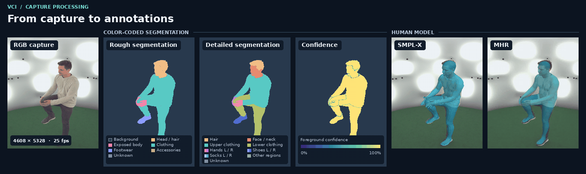

# Capture Processing

[Usage examples](examples/README.md): process one capture, run a batch, or reprocess an external dataset.

Turn a raw VCI capture into calibrated multiview media, body fits, metrics and
semantic annotations. The external reprocessing entry point accepts calibrated
observations from Multiview Data and runs the same pipeline.



*One synchronized capture: 34 color cameras, 252 frames at 25 fps (10.1 seconds). The GIF shows a 4.2-second excerpt from one camera.*

For a standalone install on Linux, run `./install.sh` with Conda on `PATH`.
See [setup](docs/setup.md) for GPU requirements, authorized models, and install
modes. If you ran the full VCI Suite installer, skip this step.

```bash
./run.sh capture-process /data/raw-captures /data/processed --workers 4
./run.sh capture-validate --subject-root /data/processed/recording
```

Run these commands from the Capture Processing checkout (or from
`capture-processing/` inside the suite). `./run.sh` uses the installed
converter Conda environment without shell activation.

The input parent contains a directory per recording with `calibration_dome.json`
and `frame_*` directories. See the [data contract](docs/schema.md). Model and
stage coverage depends on the installed environments and requested options.

To import a sequence with known camera and frame IDs:

```bash
./run.sh capture-reprocess dna /data/dna/Part1 /data/reprocessed \
  --subject example-sequence --cameras 00 08 16 24 --frames 0 1 2 3 -- \
  --workers 4 --mhr-source none --skip-smplx-to-mhr --no-semantic-parsing
```

Pass the dataset's actual sequence, camera and frame IDs. Use
`./run.sh capture-reprocess --help` for the import options and `./run.sh capture-process --help`
for processing options after `--`. Imports require synchronized images, masks
and calibration and write to a separate root. The importer uses temporary
lossless media, undistorts using the source coefficients where applicable,
links imported IDs to local IDs in the subject manifest, and calls the normal
converter. Missing views are allowed when each selected frame and camera has at
least one valid pair. The fitting stages may require additional view coverage.
Trusted 4D-DRESS input requires `--trusted-pickles`.

The specialized THuman copy, DNA and DanceNet3D processing commands remain
available during migration. GPU stages can be disabled independently, with
baseline MAMMA and fit metrics required for a completed VCI run. For resumable
processing and validation, see [operations](docs/operations.md). Run one
recording on a scheduler with [the job example](examples/processing-job.json).
